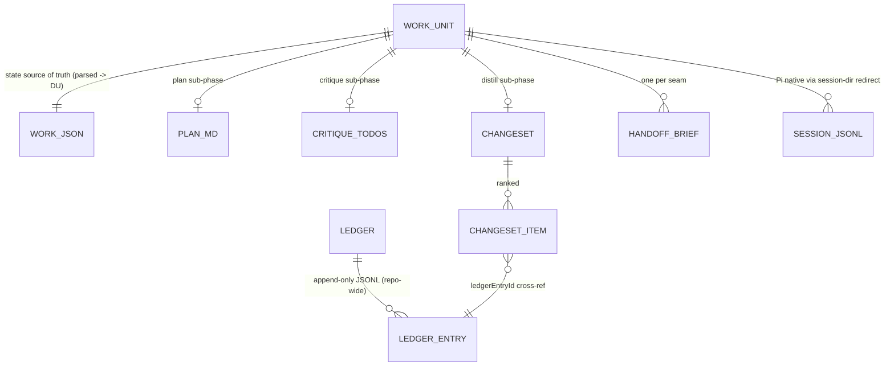

# magpi workflow layer — shape / craft / reflect loop

✨ Implement the three-umbrella workflow layer (`/shape` · `/craft` · `/reflect`) over a
branch-linked work-unit folder, with under-the-hood handoffs and a transcript-mining
`/distill` phase that makes the harness self-correcting — built as a **functional core
behind ports, with a thin imperative shell**, and **proven at every level by runnable,
recorded, replayable evidence**.

> **Repo state:** greenfield. No source, no commits — only the design records below.
> This plan stands up the Bun project scaffold and the minimal Pi-bootstrap / context-hook
> / model-profile prerequisites the Tech Spec depends on (parent
> `docs/agent-harness-design.md §10` Phases 1–3), then builds the workflow layer
> (Phases 4–5). Out of scope (spec Non-Goals): the eval head-to-head (§10 Phase 6),
> full profile tuning, eval-gated auto-apply.

## Design Docs

[SPIKE: Pi transcript feasibility (resolved feasible)](../../docs/spikes/2026-06-07-pi-transcript-feasibility-spike.md)
[ADR 0001: Shape/Craft/Reflect workflow layer](../../docs/adrs/0001-shape-craft-reflect-workflow-layer.md)
[ADR 0002: Toolchain — Bun, single-package](../../docs/adrs/0002-toolchain-bun-single-package.md)
[Tech Spec: Workflow layer](../../docs/specs/2026-06-07-workflow-layer-spec.md)

Architecture & error-handling conventions are governed by repo `CLAUDE.md` and the
`functional-error-handling` project skill — both are binding on every task below.

## Architecture & Conventions (binding)

**Hexagonal, functional core / imperative shell.** The spec's algorithms are overwhelmingly
**pure calculations** — state transitions, slug derivation, signature hashing, recurrence /
confidence math, distill synthesis (span-grouping, conflict resolution, ranking), routing
taxonomy, brief validation, gate outcomes. These live in a pure `domain/` core (plain
functions over plain data, no IO). Everything effectful — git, filesystem, Pi session
launch, subagent process spawn, transcript reading, TUI prompts, clock, id/uuid generation
— hides behind a **port** interface and is implemented by an **adapter** in the shell. The
Pi hooks and the umbrella commands are the imperative shell that wires core + ports at a
composition root.

**Error handling (`true-myth`, per the skill).** No throwing for expected failures.
- Pure core returns `Result<T, E>` (sync) or `Maybe<T>` (absence); `E` is always a
  discriminated union with a `kind` field, consumed by exhaustive `match`/`switch` + `never`.
- Shell IO returns `Task<T, E>` (a non-rejecting `Promise<Result>`); normalize unknown
  rejections at the edge with `Task.fromPromise(...).mapRejected(...)`.
- Reserve `throw` for genuine invariant violations (programmer error) only.

**Parse at the boundary.** Every on-disk artifact is untrusted input: `work.json`,
`*.json` briefs, `changeset.json`, `critique-todos.json`, and each `ledger.jsonl` line are
parsed **exactly once** at the shell via `true-myth-zod` (`parserFor` → `Result`,
`asyncParserFor` → `Task`) into typed domain values. The core never re-validates.

**Make illegal states unrepresentable.** The in-core `WorkUnit` is a discriminated union
on lifecycle state, each variant carrying only the data legal in that state (e.g. only the
`blocked` variant has `blockedReason`; only `crafting` has `craftCheckpointRef`). The
persisted `work.json` keeps the spec §1 shape; the boundary parser **lifts** it into the DU
and the store **lowers** the DU back on write. Transition functions are total and
exhaustive.

**Toolchain (Bun, per [ADR 0002](../../docs/adrs/0002-toolchain-bun-single-package.md)).**
Bun is runtime + test runner + bundler + package manager (single package). Bun runs TS but
does **not** type-check, so the verification gate is `bun test` && `bun x tsc --noEmit` —
both clean before any commit (`tsc` is the type authority). No fp-ts/effect, no
category-theory vocabulary in app code. The Bun↔Pi assumption is gated in Task 1 with a
documented Node+`tsx`+`vitest` fallback.

### Module layout (ports & adapters)

```
src/
  domain/                      # FUNCTIONAL CORE — pure, no IO; returns Result/Maybe
    workunit/
      model.ts                 # WorkUnit discriminated union; const-union types; never-check helper
      transitions.ts           # transition(unit, event): Result<WorkUnit, TransitionError>  (total, exhaustive)
      recovery.ts              # recoveryAction(persisted): RecoveryAction
      slug.ts                  # deriveSlug(summary, {crc, salt}): Slug   (deterministic; entropy injected)
      gate.ts                  # gate-rejection retry decisions (Gate 1 / Gate 3) as pure reducers
    briefs/
      validate.ts              # validateBrief(brief, knownPaths): Result<ValidBrief, BriefError>
      render.ts                # renderBrief(valid): string   (system-prompt block, cache-eligible)
    ledger/
      signature.ts             # signature(finding): Signature   (sha256[0..12] of normalized core)
      recurrence.ts            # bump / confidence start+increment+cap / lazy 90-day decay (now injected)
    distill/
      lenses.ts                # 4 lens analyzers: (FileEntry[]) -> Finding[]   (pure over transcript entries)
      synthesis.ts             # synthesize(findings, ledger, now): Result<Changeset, SynthesisError>
      routing.ts               # routeFriction(finding): {routingType, artifactType}  (taxonomy)
    changeset/
      review.ts                # applyDecision(changeset, decision): Result<Changeset, ReviewError>  (reducer)
      apply-plan.ts            # decideApply(changeset): ApplyOutcome  (full/partial/full-reject)
    profiles.ts                # Seam-2 model-profile record (pure data, const)
  ports/                       # INTERFACES the core needs from the world (typed; Task/Result/Maybe)
    clock.ts ids.ts file-system.ts git.ts work-store.ts ledger-store.ts
    session-launcher.ts subagent-runner.ts transcript-reader.ts prompter.ts
  boundary/                    # PARSE-AT-THE-BOUNDARY — zod schemas + true-myth-zod parsers
    schemas.ts parsers.ts      # work.json, brief, changeset, critique-todos, ledger; lift/lower DU
  adapters/                    # IMPERATIVE SHELL — concrete port impls (Bun IO)
    bun-clock.ts uuid-ids.ts bun-fs.ts git-cli.ts
    pi-session-launcher.ts pi-subagent-runner.ts pi-transcript-reader.ts tui-prompter.ts
    work-store-fs.ts ledger-store-fs.ts
  shell/                       # ORCHESTRATION — commands + hooks wire core to ports
    hooks/{index,session-start,session-shutdown,before-agent-start,
           context,session-before-compact,tool-call}.ts
    commands/{shape,craft,reflect,apply}.ts
    phases/{explore,define,plan,craft,critique}.ts
    phases/distill/orchestrator.ts
  compose.ts                   # composition root: build real adapters, inject into shell
  cli.ts                       # entry point: dispatch /shape /craft /reflect /apply
test/
  domain/**                    # pure unit + property (fast-check) tests — zero IO, zero fakes needed
  support/fakes/**             # in-memory fake for every port (the test substrate)
  fixtures/transcripts/**      # recorded golden Pi JSONL + subagent JSON (record/replay corpus)
  replay/**                    # replay adapters: feed fixtures through shell deterministically
  acceptance/sc-*.test.ts      # one test per Success Criterion; each emits an evidence record
  architecture/boundaries.test.ts  # fitness fn: domain/ imports no IO/adapters/ports-impl/node/bun
  e2e/full-loop.test.ts        # whole-loop replay → whole-plan evidence artifact
```

Work-unit data artifacts (Tech Spec §1) and their cross-refs:



The lifecycle state machine (states, transitions, crash recovery) is specified in
**Tech Spec §2** — realized as the pure `domain/workunit/` core; not duplicated here.

## Verification & Evidence Strategy

The goal: after **every task, every commit, and the whole plan**, produce something I can
**run, record, and replay** that proves the work is complete *and* simple, elegant, and
high-quality — to you and to myself. Three levels, each with a concrete, automated proof.

### What makes this provable: the architecture is the test seam

Because effects hide behind ports, **every test is deterministic and offline**:
- The **pure core** needs no fakes at all — it is plain functions, exercised by example
  tests and **property-based tests** (`fast-check`) that assert invariants over thousands
  of generated inputs.
- The **shell** is tested by injecting **in-memory fakes** or **replay adapters** for the
  ports — never live models, git, or disk-of-record.

### Record · replay (the harness's own medium is the test substrate)

magpi's premise is mining Pi's append-only JSONL transcripts. We turn that into the
testing strategy:
1. **Record once.** Run each autonomous phase (plan / craft / distill) and the lens workers
   against a small fixture project; commit the resulting `sessions/*.jsonl` and subagent
   JSON outputs as **golden fixtures** under `test/fixtures/transcripts/`.
2. **Replay deterministically.** The distill lenses + synthesis are **pure over transcript
   entries**, so replay = feed golden entries in and **snapshot** the `changeset.json` out
   — no network, fully repeatable. For command orchestration, a **replay `SessionLauncher`
   / `SubagentRunner`** plays back a recorded transcript instead of spawning live Pi; a
   **scripted `Prompter`** plays back recorded human accept/reject/skip decisions. This is
   literally "record once, play it back."
3. **Evidence record.** Each acceptance test writes a small machine-readable evidence entry
   (criterion id, fixtures used, assertions, pass/fail, key values) to `test/_evidence/` so
   the proof is itself inspectable and replayable — not just a green checkmark.

### Proving "simple, elegant, high quality" (mechanically, not by assertion)

> **Right-sized for greenfield agility.** The proofs below split into two tiers. The
> **day-one tier** is cheap, high-value, and does not ossify an unsettled design — it runs
> from the first commit. The **deferred ratchet** (strict coverage thresholds, complexity
> budgets, and any heavier rigor) is added *once the design stabilizes*, so verification
> never competes with iteration speed. The extra rigor is mostly for the implementer's own
> confidence; it is opt-in later, not an upfront tax.

**Day-one tier (from commit 1):**
- **Type safety:** `bun x tsc --noEmit` strict; zero `any`/`as` escapes in the core.
- **Architecture fitness test:** an automated test asserts `src/domain/**` imports nothing
  from `adapters/`, port implementations, `node:*`, `bun`, `child_process`, or `fs` — the
  dependency-direction proof that the core is genuinely pure and the hexagon holds.
- **Exhaustiveness:** every union `match`/`switch` ends in a `never` check; tsc fails if a
  case is missed — illegal states stay unrepresentable by construction.
- **Property tests for the pure core** (`fast-check`) and **record/replay** for the
  autonomous phases — correctness where it lives, deterministic and offline.
- **No-throw / no-hand-parse checks:** lint rule + a grep-based test that there is no
  `JSON.parse` on `.jsonl` outside the Pi loader (Tech Spec SC #7), and no `throw` for
  control flow in `domain/`. (Cheap, and they guard load-bearing invariants.)
- **`bun run verify`** runs exactly the above — fast, never blocks iteration.

**Deferred ratchet (added once the design stabilizes — not before):**
- **Coverage gate:** `bun test --coverage` with a threshold, core held higher than shell.
- **Simplicity/complexity budget** via Biome (max function length / cyclomatic complexity,
  no mutable shared state). Introduced as a follow-up so it tightens around a settled shape
  rather than freezing an exploratory one.

### The verification ritual (what I run at each level during `/workflows:work`)

| Level | I run | I record / replay | Proof of done |
|---|---|---|---|
| **Per task** | the task's own unit/property tests + the gate (`bun test` && `bun x tsc --noEmit`) | new fixtures if the task is a phase/worker | task's Definition-of-Done checks all green; fitness + lint clean |
| **Per commit** | `bun run verify` (gate + fitness + scans) + the acceptance test(s) that commit turns green | the recorded acceptance evidence for that commit's SC(s) | the commit's `Deployable` claim demonstrated by a named, replayable test |
| **Whole plan** | the full `test/acceptance/**` matrix + the replay-driven `e2e/full-loop` | the whole-plan evidence artifact (all SC evidence records + a full-loop replay) | every Success Criterion has a green, recorded, replayable proof |

### Acceptance matrix (every Success Criterion → a named, runnable test)

| SC | Proof test | Mechanism |
|---|---|---|
| SC #1 no manual `/compact` | `acceptance/sc-1-no-compact.test.ts` | replay full loop; assert no user `/compact` entry in any transcript |
| SC #2 native transcript capture | `acceptance/sc-2-native-sessions.test.ts` | launch via redirect; assert one Pi-written `.jsonl` per session, no symlink/copy |
| SC #3 crash-safe craft resume | `acceptance/sc-3-craft-resume.test.ts` | kill mid-craft (replay), re-enter; assert state + checkpoint SHA intact |
| SC #4 recurrence-gated distill | `acceptance/sc-4-recurrence.test.ts` | replay 2 work units sharing friction; assert changeset item `recurrenceCount>=2` |
| SC #5 Gate-1 retry cap | `acceptance/sc-5-gate1-cap.test.ts` | property/example: reject plan twice → state reverts to `shaping (define)` |
| SC #6 partial Gate-3 | `acceptance/sc-6-partial-apply.test.ts` | accept some/reject some → applied + ledger `rejected` + `completed` |
| SC #7 loader-only JSONL | `acceptance/sc-7-loader-only.test.ts` | static scan: no `JSON.parse` on `.jsonl` outside the loader |
| SC #8 six hooks fire | `acceptance/sc-8-hooks-fire.test.ts` | run with hook-call logging; assert all six fired without error |

## Tasks

> Each task names its **hex role** (core/port/adapter/boundary/shell), its **error shape**
> (`Result`/`Task`/`Maybe`/data), and its **evidence** (the test that proves it). The gate
> (`bun test` && `bun x tsc --noEmit`) is implied Definition-of-Done for every task.

### Milestone A — Toolchain, hexagonal skeleton & boundary (parent §10 Phase 1)

- [ ] **Task 1 — Bun project scaffold + dependencies + Bun↔Pi go/no-go gate.** `package.json` (Bun; `@earendil-works/pi-coding-agent` **pinned exact**; `true-myth@^9`, `zod@>=3.25`, `true-myth-zod`; dev: `fast-check`, `@biomejs/biome`), `tsconfig.json` (strict, ESM), Biome config, the `src/{domain,ports,boundary,adapters,shell}` + `test/` skeleton, and scripts wiring the `bun test` + `bun x tsc --noEmit` gate. **Go/no-go gate (do this first, it is the riskiest assumption — ADR 0002):** confirm Pi imports cleanly under Bun **and** one real session launches + writes its JSONL under a redirected session dir. *Pass →* proceed on Bun. *Fail →* execute the documented fallback: swap the runtime/test-runner to **Node + `tsx` + `vitest`** (architecture, ports/adapters, and all tests carry over unchanged; ~half a day) and note the swap in ADR 0002. — *Role:* shell/tooling · *Evidence:* gate runs green on an empty suite; the Pi-on-Bun probe is recorded as the first evidence record. — Design Doc refs: [ADR 0002 (toolchain + fallback)], [Tech Spec §12 `@earendil-works/`], [SPIKE Residual risk #1, #2]
- [ ] **Task 2 — Port interfaces (`src/ports/*.ts`).** Typed interfaces only: `Clock.now()`, `Ids.uuidv7()/crc32()`, `FileSystem.exists/read/atomicWrite`, `Git.currentBranch/checkoutNew/adopt/stashCheckpoint`, `WorkStore.read/write`, `LedgerStore.append/read`, `SessionLauncher.launch`, `SubagentRunner.spawn`, `TranscriptReader.loadEntries/latestCompaction`, `Prompter.choose`. IO ports return `Task<…, E>` with `E` a `kind`-tagged union. — *Role:* port · *Error shape:* `Task`/`Result` signatures · *Evidence:* `tsc` compiles; fakes in Task 6 implement each. — Design Doc refs: [CLAUDE.md ports-and-adapters], [Tech Spec §12]
- [ ] **Task 3 — Boundary schemas + parsers (`src/boundary/{schemas,parsers}.ts`).** `zod` schemas for `work.json`, handoff brief, `changeset.json`, `critique-todos.json`, ledger line; `parserFor`/`asyncParserFor` yielding `Result`/`Task`; lift parsed `work.json` → `WorkUnit` DU and lower DU → persisted shape. — *Role:* boundary · *Error shape:* `Result<T, ZodError>` · *Evidence:* round-trip property test (lower∘lift = id) in Task 11; malformed-input rejection tests. — Design Doc refs: [functional-error-handling: parse-at-boundary], [Tech Spec §1 schemas]
- [ ] **Task 4 — Effect adapters: fs / clock / ids / git (`src/adapters/{bun-fs,bun-clock,uuid-ids,git-cli}.ts`).** Concrete Bun/CLI implementations of those ports; `bun-fs.atomicWrite` = write `.tmp` + `rename`; `git-cli` via `Bun.$`. Unknown rejections normalized with `.mapRejected`. — *Role:* adapter · *Error shape:* `Task` · *Evidence:* adapter integration tests against a tmp dir / throwaway git repo. — Design Doc refs: [Tech Spec §1 atomic write], [Tech Spec §3 git], [functional-error-handling: boundary interop]
- [ ] **Task 5 — Pi adapters: transcript-reader + session-launcher (`src/adapters/{pi-transcript-reader,pi-session-launcher}.ts`).** `pi-transcript-reader` wraps Pi's exported `loadEntriesFromFile`/`getLatestCompactionEntry`/`parseSessionEntries` (the **only** JSONL reader; SC #7); `pi-session-launcher` launches a session with `PI_CODING_AGENT_SESSION_DIR` = absolute `sessions/`. — *Role:* adapter · *Error shape:* `Task` · *Evidence:* `acceptance/sc-2`, `acceptance/sc-7`. — Design Doc refs: [Tech Spec §12 loader + redirect], [SPIKE Q2, Q6]
- [ ] **Task 6 — Test substrate: in-memory fakes for every port + architecture-fitness test (`test/support/fakes/**`, `test/architecture/boundaries.test.ts`).** A deterministic fake per port (fake clock, seeded ids, in-memory fs/store/ledger, scriptable launcher/subagent/prompter); the fitness test asserting `domain/` imports no IO. — *Role:* test infra · *Evidence:* fitness test runs and (initially trivially) passes; fakes type-check against the ports. — Design Doc refs: [CLAUDE.md functional core], [Verification & Evidence Strategy]

### Milestone B — Work-unit domain core, pure (parent §10 Phase 4 substrate)

- [ ] **Task 7 — WorkUnit model (`src/domain/workunit/model.ts`).** `WorkUnit` discriminated union on state (illegal states unrepresentable); `WorkUnitState`/`WorkUnitPhase`/`BriefName`/`LensName`/`RoutingType`/`ArtifactType` as `const` string-literal unions (no enums); `assertNever` helper. — *Role:* core · *Error shape:* data · *Evidence:* type-level tests (illegal combos fail to compile); construction unit tests. — Design Doc refs: [CLAUDE.md illegal-states-unrepresentable], [Tech Spec §1, §6]
- [ ] **Task 8 — Pure transition function (`src/domain/workunit/transitions.ts`).** `transition(unit, event): Result<WorkUnit, TransitionError>` encoding the full §2 graph; exhaustive `switch` + `never`; undefined transitions → `err({kind:'IllegalTransition', …})`. — *Role:* core · *Error shape:* `Result` · *Evidence:* example tests for every edge + property test "no event from any state ever throws or yields an illegal state" (SC #5 backbone). — Design Doc refs: [Tech Spec §2 transition graph]
- [ ] **Task 9 — Pure crash-recovery decision (`src/domain/workunit/recovery.ts`).** `recoveryAction(persisted): RecoveryAction` returning the §2 recovery-table action as data (resume / no-op / clean-orphan / discard-tmp / display-blocked). — *Role:* core · *Error shape:* `Result`/data · *Evidence:* table-driven tests for each state; feeds `acceptance/sc-3`. — Design Doc refs: [Tech Spec §2 crash recovery], [Tech Spec Error Handling #2]
- [ ] **Task 10 — Pure slug derivation (`src/domain/workunit/slug.ts`).** `deriveSlug(summary, {crc, salt})` — kebab-case normalize, 4-hex crc suffix, deterministic; collision resolver `-2/-3` as a pure fold over an existing-slug set. Entropy/crc supplied by caller (Ids port at the shell). — *Role:* core · *Error shape:* data · *Evidence:* property tests (determinism, charset, length cap, collision uniqueness). — Design Doc refs: [Tech Spec §3], [Tech Spec Error Handling #5]
- [ ] **Task 11 — WorkStore adapter + recovery wiring (`src/adapters/work-store-fs.ts`, shell glue).** Compose boundary parser + `bun-fs.atomicWrite` into `WorkStore`; harness is sole mutation authority; on read apply `recoveryAction`; `.tmp` orphan discard. — *Role:* adapter/shell · *Error shape:* `Task` · *Evidence:* round-trip property test (lift∘read∘write∘lower = id); crash-simulation test (orphan `.tmp`, partial folder). — Design Doc refs: [Tech Spec §1 atomic write, §2 authority], [Tech Spec Error Handling #4], [Tech Spec §3 branch↔folder]

### Milestone C — Briefs, model profiles, Pi hooks (parent §10 Phases 2–3, prerequisite for Phase 4)

- [ ] **Task 12 — Pure brief validate + render (`src/domain/briefs/{validate,render}.ts`).** `validateBrief(brief, knownPaths): Result<ValidBrief, BriefError>` — `schemaVersion "1"`, ≥1 decision, `briefType`-matches-seam, every `artifacts` path ∈ `knownPaths` (path **set** injected — existence check stays pure); `renderBrief` → the cache-eligible system-prompt block. — *Role:* core · *Error shape:* `Result` · *Evidence:* unit tests per failure `kind`; render snapshot. — Design Doc refs: [Tech Spec §1 HandoffBrief, §10 validation/injection], [Tech Spec Error Handling #1]
- [ ] **Task 13 — Seam-2 model profiles (`src/domain/profiles.ts`).** `const` discriminated record keyed by model: routing role, thinking budget, context-window, parallel-tool-call; minimal Claude + Codex. — *Role:* core (data) · *Evidence:* type + lookup tests. — Design Doc refs: [agent-harness §6.1 Seam 2, §10 Phase 3], [Tech Spec §11 routing]
- [ ] **Task 14 — Register the six Pi hooks (`src/shell/hooks/*`).** `session_start`, `session_shutdown`, `before_agent_start`, `context`, `session_before_compact`, `tool_call` as adapters translating Pi events → core calls (validate/render brief, request transitions, enforce semaphore). — *Role:* shell · *Error shape:* `Task` at the edge · *Evidence:* `acceptance/sc-8` (all six fire). — Design Doc refs: [Tech Spec §12 hooks], [SPIKE Q5], [agent-harness §6.2]
- [ ] **Task 15 — Auto-clear-and-reseed handoff (`src/shell/hooks/{session-shutdown,session-start}.ts`).** Shutdown: render+write outgoing brief, request state advance via WorkStore, record craft checkpoint SHA. Start: parse+validate incoming brief, inject via `newSession({withSession})`; on missing artifact → transition to `blocked`. — *Role:* shell · *Error shape:* `Task`/`Result` · *Evidence:* replay test of a seam handoff; `blocked`-on-missing-artifact test. — Design Doc refs: [ADR §4], [Tech Spec §7 seam], [SPIKE Q5 `handoff.ts`]
- [ ] **Task 16 — context-trim + compaction hooks (`src/shell/hooks/{context,session-before-compact}.ts`).** `context`: lean-active-context trim (drop stale tool results), reading from profile. `session_before_compact`: write pre-compact brief; optional cheaper summarizer. — *Role:* shell · *Error shape:* `Task` · *Evidence:* trim-policy unit test (pure policy) + hook integration test. — Design Doc refs: [agent-harness §6.2], [Tech Spec §12], [ADR Accepted trade-offs (compaction lossy)]

### Milestone D — `/shape` umbrella (parent §10 Phase 4)

- [ ] **Task 17 — `/shape` + explore (`src/shell/commands/shape.ts`, `src/shell/phases/explore.ts`).** Create work unit (slug via Ids+Git ports, branch), boot explore; `--branch`, `--abandon <slug>`, resume-on-existing. — *Role:* shell · *Error shape:* `Task` · *Evidence:* command test with fake ports (creates folder, branch, `created`→`shaping`). — Design Doc refs: [Tech Spec §3, §9], [ADR §1]
- [ ] **Task 18 — explore→define & define→plan seams (`src/shell/phases/define.ts`, `/define` + `/plan`).** Explicit user-signal transitions only; write seam brief; `/plan` launches the autonomous plan session. — *Role:* shell · *Evidence:* seam replay test (brief written, next sub-phase seeded). — Design Doc refs: [Tech Spec §7], [ADR Determination (explicit seams)]
- [ ] **Task 19 — Autonomous plan sub-phase (`src/shell/phases/plan.ts`).** Run plan agent to completion via `SessionLauncher`; write `plan.md` (frontmatter `status`/`retryCount`); → `plan-pending-gate`. — *Role:* shell · *Error shape:* `Task` · *Evidence:* replay test using a golden plan transcript → asserts `plan.md` + state. — Design Doc refs: [Tech Spec §1 plan.md, §2], [ADR §1]
- [ ] **Task 20 — Gate-1 plan-rejection re-entry (`src/domain/workunit/gate.ts` + `shape.ts --reject-plan`).** Pure `gate1Decision(retryCount, feedback)` → retry|fallback; shell re-runs plan with feedback injected or reverts to `shaping (define)`; ledger `observed` record on rejection. — *Role:* core + shell · *Error shape:* `Result` · *Evidence:* `acceptance/sc-5` (≤2 retries → revert). — Design Doc refs: [Tech Spec §4 Gate 1], [Tech Spec SC #5]

### Milestone E — `/craft` umbrella (parent §10 Phase 4)

- [ ] **Task 21 — `/craft` + autonomous craft (`src/shell/commands/craft.ts`, `src/shell/phases/craft.ts`).** Gate-1 entry from `plan-pending-gate`; seed `plan-to-craft` brief; clean exit (changes, no BLOCKED) → `awaiting-reflect`. — *Role:* shell · *Error shape:* `Task` · *Evidence:* replay test of a golden craft transcript. — Design Doc refs: [Tech Spec §5], [ADR §5]
- [ ] **Task 22 — Craft failure handling + checkpoint (`src/shell/phases/craft.ts`; pure decision in `domain`).** Pre-craft `git.stashCheckpoint` (store `craftCheckpointRef`); pure `craftOutcome(transcript)` detects BLOCKED after 3 consecutive failure cycles → `blocked` + `blockedReason`; resume re-injects checkpoint SHA; cross-invocation `retryCount>=2` stays `blocked`. — *Role:* core + shell · *Error shape:* `Result`/`Task` · *Evidence:* `acceptance/sc-3` (kill-replay-resume). — Design Doc refs: [Tech Spec §5], [Tech Spec Error Handling #2], [Tech Spec SC #3]

### Milestone F — `/reflect` critique sub-phase (parent §10 Phase 4)

- [ ] **Task 23 — `/reflect` + critique (`src/shell/commands/reflect.ts`, `src/shell/phases/critique.ts`).** Gate-2 entry from `awaiting-reflect` (optional, never forced); collaborative guided tour from the harness's multi-lens review; write `critique-todos.json`. — *Role:* shell · *Error shape:* `Task` · *Evidence:* command test; bypass-to-distill (no todos) path test. — Design Doc refs: [Tech Spec §7], [ADR §5, §6]
- [ ] **Task 24 — Critique disposition + rework (`src/domain/...` pure routing + `critique.ts`).** Pure `disposition(item)` → routing; `critical`→`fix-in-place`→`rework` (+ rework brief, 3-cycle budget) → `reflecting (distill)`; `minor`→`deferred`/`spawn-child` (child work unit, `parentSlug`)/`accepted-as-is`. — *Role:* core + shell · *Error shape:* `Result` · *Evidence:* disposition-routing property test; rework-cycle replay test. — Design Doc refs: [Tech Spec §7], [Tech Spec §2 rework]

### Milestone G — `/distill` + ledger + subagents (parent §10 Phase 5)

- [ ] **Task 25 — Subagent runner adapter + concurrency semaphore (`src/adapters/pi-subagent-runner.ts`, `tool_call` hook).** Spawn `pi --mode json -p --no-session --session-dir /dev/null`; parse `message_end`; pure semaphore policy (cap 4) enforced in `tool_call`; retry a failed worker once → `worker_failure` annotation. — *Role:* adapter + shell (pure policy in core) · *Error shape:* `Task` · *Evidence:* concurrency-policy property test; replay test with a scripted subagent runner. — Design Doc refs: [Tech Spec §11], [ADR §7], [SPIKE additional finding]
- [ ] **Task 26 — Learnings ledger (`src/domain/ledger/{signature,recurrence}.ts` + `src/adapters/ledger-store-fs.ts`).** Pure `signature = sha256(lens:routingType:normalizedDescription)[0..12]`, recurrence bump+dedup, confidence start 0.5/+0.2/cap 1.0, lazy 90-day decay (now injected); append-only `ledger.jsonl` via adapter, status lifecycle. — *Role:* core + adapter · *Error shape:* `Result`/`Task` · *Evidence:* property tests (signature stability, confidence monotonic+capped, decay floor); `acceptance/sc-4`. — Design Doc refs: [Tech Spec §6 ledger + decay + signature], [Tech Spec Determination (threshold 2)], [ADR §6]
- [ ] **Task 27 — Distill lens analyzers (`src/domain/distill/lenses.ts`).** Four pure analyzers over `FileEntry[]` (`duplicated-work`, `rabbit-holes`, `context-waste`, `handoff-gaps`); compaction handling: use `getLatestCompactionEntry`, analyze only entries ≥ `firstKeptEntryId`, flag `low_fidelity` when >50% lossy. Transcript entries supplied by `TranscriptReader`. — *Role:* core · *Error shape:* data/`Result` · *Evidence:* per-lens tests over golden transcript fixtures (the record/replay corpus). — Design Doc refs: [Tech Spec §6 fan-out + CompactionEntry], [SPIKE Q3 lens→field]
- [ ] **Task 28 — Distill synthesis + changeset (`src/domain/distill/{synthesis,routing}.ts` + `shell/phases/distill/orchestrator.ts`).** Pure `synthesize(findings, ledger, now)`: span-group, fix-type-priority conflict resolution (hook > brief > agents-md/memory > command > model-profile/skill), routing taxonomy, ledger cross-ref, recurrence≥2 gate, rank → `Result<Changeset, …>`; orchestrator fans out workers (Task 25) and writes `changeset.json` → `changeset-pending-gate`. — *Role:* core + shell · *Error shape:* `Result` · *Evidence:* synthesis snapshot over golden findings; ranking/conflict property tests; `acceptance/sc-4`. — Design Doc refs: [Tech Spec §6 synthesis], [Tech Spec §1 changeset], [ADR §6 taxonomy]

### Milestone H — Changeset review, Gate 3, `/apply`, ledger inspect (parent §10 Phases 4–5)

- [ ] **Task 29 — Changeset review UX (`src/domain/changeset/review.ts` + `src/adapters/tui-prompter.ts`).** Pure `applyDecision(changeset, decision)` reducer; render §8 markdown block; interactive per-item `[A]ccept/[R]eject/[S]kip` via `Prompter` port; no Gate-3 advance while any item `pending`. — *Role:* core + adapter · *Error shape:* `Result` · *Evidence:* reducer property test (no-pending invariant); scripted-prompter replay test. — Design Doc refs: [Tech Spec §8]
- [ ] **Task 30 — `/apply` Gate 3 + application (`src/domain/changeset/apply-plan.ts` + `src/shell/commands/apply.ts`).** Pure `decideApply(changeset)` → full-accept|partial|full-reject; apply accepted items by `artifactType` (shell), write rejected → ledger `rejected`; full-reject retries distill (`retryCount<2`) or falls back to critique (`>=2`); → `completed`. — *Role:* core + shell · *Error shape:* `Result`/`Task` · *Evidence:* `acceptance/sc-6` (partial). — Design Doc refs: [Tech Spec §4 Gate 3, §6], [Tech Spec SC #6]
- [ ] **Task 31 — Ledger inspect/prune/reset (`src/domain/ledger/...` pure transforms + `src/shell/...`).** `/distill --inspect` (markdown table in TUI); `--prune <id>` → `evicted` (retained for audit); `--reset <id>` → `observed` (clear note, recurrence→1). — *Role:* core + shell · *Error shape:* `Result` · *Evidence:* transform unit tests; inspect render snapshot. — Design Doc refs: [Tech Spec §6 inspect/prune surface]

### Milestone I — Verification, evidence & end-to-end (cross-cutting proof)

- [ ] **Task 32 — Property-based core suite (`test/domain/**` with `fast-check`).** Invariants: transitions never yield illegal states (SC #5); slug determinism/charset/collision; brief-validate totality; recurrence monotonic+capped; decay floor; signature stability; synthesis ranking order; review no-pending invariant. — *Role:* test · *Evidence:* the suite itself, green; `domain/` exercised broadly (a coverage *threshold* is the deferred ratchet, not asserted here). — Design Doc refs: [Verification & Evidence Strategy], [CLAUDE.md functional core]
- [ ] **Task 33 — Record/replay fixtures + replay adapters (`test/fixtures/transcripts/**`, `test/replay/**`).** Record golden Pi transcripts + subagent JSON for plan/craft/distill against a fixture project; replay `SessionLauncher`/`SubagentRunner` and scripted `Prompter` that play them back deterministically. — *Role:* test infra · *Evidence:* a replay run reproduces a recorded changeset byte-for-byte. — Design Doc refs: [Verification & Evidence Strategy], [SPIKE Q2/Q3]
- [ ] **Task 34 — Acceptance matrix + evidence records (`test/acceptance/sc-*.test.ts`, `test/_evidence/`).** One named test per Success Criterion (SC #1–8) per the matrix above; each writes a machine-readable evidence record (criterion, fixtures, assertions, result). — *Role:* test · *Evidence:* 8 green acceptance tests + 8 evidence records. — Design Doc refs: [Tech Spec Success Criteria #1–8], [Verification & Evidence Strategy]
- [ ] **Task 35 — `bun run verify` (day-one tier only) + ritual doc.** Wire one `bun run verify` = `bun test` && `bun x tsc --noEmit` + architecture-fitness (Task 6) + `JSON.parse`-on-`.jsonl` scan (SC #7) + no-`throw`-in-`domain` scan. **Deliberately excludes** strict coverage thresholds and the complexity budget — those are the deferred ratchet (a later follow-up once the design stabilizes; see Verification & Evidence Strategy), so the gate stays fast and never blocks iteration. Document the per-commit ritual in `AGENTS.md`. — *Role:* tooling · *Evidence:* `bun run verify` green and quick; SC #7 test. — Design Doc refs: [Verification & Evidence Strategy (right-sizing)], [Tech Spec SC #7]
- [ ] **Task 36 — Full-loop E2E + whole-plan evidence artifact (`test/e2e/full-loop.test.ts`).** Replay-drive `/shape`→`/craft`→`/reflect`→`/apply` on a fixture; assert SC #1/#2/#3/#8 in one run; emit the consolidated whole-plan evidence artifact (all SC records + the full-loop replay manifest). — *Role:* test · *Evidence:* one green E2E producing the replayable artifact. — Design Doc refs: [Tech Spec Success Criteria #1, #2, #3, #8], [Verification & Evidence Strategy]

## Commit Sequence

<!-- Re-sequenced by commit-sequencer after the hexagonal + verification rework. -->

| Commit # | Task # | Deployable | Task Complete | Task Committed |
|----------|--------|------------|---------------|----------------|
| 1 | 1, 2, 3 | Hexagonal skeleton compiles and gates pass on an empty suite; `bun test` + `tsc --noEmit` are green; **Bun↔Pi go/no-go gate cleared** (or fallback taken per ADR 0002); all port interfaces and boundary schemas exist so every later commit has a stable contract to build against. | | |
| 2 | 6 | Architecture-fitness test asserts `domain/` imports no IO (trivially passes on an empty domain); every port has a typed in-memory fake so any future test can inject them without live IO. | | |
| 3 | 4, 5 | All effect adapters (fs/clock/ids/git/Pi transcript-reader/session-launcher) compile and pass their integration tests; the full adapter layer is shippable as a standalone Bun IO toolkit. | | |
| 4 | 7, 8, 9, 10 | Pure work-unit domain core (model DU, transitions, recovery, slug) is fully typed and property-tested; fitness test confirms zero IO imports; deployable as a zero-dependency pure library. | | |
| 5 | 11 | WorkStore adapter wires boundary parsers + atomic-write + recovery; round-trip and crash-simulation tests pass; the harness can now safely read and write `work.json` with full crash recovery. | | |
| 6 | 12, 13 | Brief validate/render and model profiles are pure, typed, and snapshot-tested; the context-injection contract that hooks and commands depend on is complete. | | |
| 7 | 35 | `bun run verify` (day-one tier: `bun test` + `tsc --noEmit` + architecture-fitness + SC-7 scan + no-throw-in-domain scan) is wired, fast, and green; every subsequent commit runs it. Strict coverage/complexity ratchet is deferred to a later follow-up so the gate doesn't ossify the design. | | |
| 8 | 14, 15, 16 | All six Pi hooks are registered and wire core calls; handoff reseed (shutdown→start brief pass-through) and context-trim/compaction hooks pass integration tests; `acceptance/sc-8` scaffold is green. | | |
| 9 | 32 | Property-based core suite covers transition invariants, slug, brief-validate, recovery, recurrence math, and signature stability; `domain/` is exercised broadly; SC #5 backbone (transitions never yield illegal states) is mechanically proven. | | |
| 10 | 33 | Golden Pi transcript fixtures and replay adapters (SessionLauncher, SubagentRunner, scripted Prompter) land; a replay run byte-for-byte reproduces a recorded changeset; all subsequent shell-command tests can run offline via replay. | | |
| 11 | 17, 18 | `/shape` command and explore→define seams are wired; fake-port command tests pass (work-unit folder + branch created, `created`→`shaping` transition); seam brief written on define signal. | | |
| 12 | 26 | Learnings ledger core (signature, recurrence, decay math) + `ledger-store-fs` adapter land; property tests (signature stability, confidence monotonic+capped, decay floor) pass; ledger is independently shippable before any command writes to it. | | |
| 13 | 19 | Autonomous plan sub-phase runs via replay SessionLauncher; golden transcript test asserts `plan.md` written + state → `plan-pending-gate`; deployable as a complete plan phase. | | |
| 14 | 20 | Gate-1 pure decision + rejection re-entry wired; `acceptance/sc-5` (≤2 retries → revert to `shaping (define)`) is green; ledger `observed` record written on rejection. | | |
| 15 | 21, 22 | `/craft` umbrella + craft failure/checkpoint land together; `craftOutcome` BLOCKED detector, checkpoint SHA, and resume path are co-deployed (splitting would leave craft without its crash-safety invariant); `acceptance/sc-3` is green. | | |
| 16 | 23, 24 | `/reflect` + critique disposition routing land together; disposition is exercised directly by the reflect command and has no safe intermediate state; rework-cycle replay test passes. | | |
| 17 | 25 | Subagent runner adapter + semaphore policy (cap 4, `tool_call` enforcement, one retry → `worker_failure`) land; concurrency-policy property test and scripted-runner replay pass; distill orchestrator can now fan out workers. | | |
| 18 | 27 | Four pure distill lens analyzers (`duplicated-work`, `rabbit-holes`, `context-waste`, `handoff-gaps`) + compaction-aware logic pass per-lens golden-fixture tests; deployable as an offline transcript analysis toolkit. | | |
| 19 | 28 | Distill synthesis + routing taxonomy + orchestrator land; synthesis snapshot + ranking/conflict property tests pass; orchestrator fans out lens workers and writes `changeset.json`; `acceptance/sc-4` (recurrence≥2 gate) is green. | | |
| 20 | 31 | Ledger inspect/prune/reset (pure transforms + shell surface) land; transform unit tests and inspect render snapshot pass; `/distill --inspect` is independently useful without any changeset in flight. | | |
| 21 | 29 | Changeset review UX (pure reducer + `tui-prompter` adapter) lands; no-pending-items invariant property test and scripted-prompter replay pass; the interactive accept/reject/skip loop is shippable before Gate-3. | | |
| 22 | 30 | `/apply` Gate-3 + application logic land; `acceptance/sc-6` (partial apply: accepted items applied, rejected items → ledger `rejected`, state → `completed`) is green; the full lifecycle through `/apply` is now deployable. | | |
| 23 | 34 | Acceptance matrix (sc-1 through sc-8) with machine-readable evidence records lands; all eight acceptance tests are green given the fixtures and replay adapters from commit 10; evidence records in `test/_evidence/` are written and inspectable. | | |
| 24 | 36 | Full-loop E2E replay drives `/shape`→`/craft`→`/reflect`→`/apply` on a fixture and asserts SC #1/#2/#3/#8 in one run; consolidated whole-plan evidence artifact (all SC records + replay manifest) is emitted; the plan is proven end-to-end. | | |

## Acceptance Criteria

Every criterion is a **named, runnable, recorded** test (see the Acceptance Matrix); a
criterion is "met" only when its test is green *and* its evidence record exists.

- [ ] **SC #1 — Full loop, no manual context management.** `acceptance/sc-1` green.
- [ ] **SC #2 — Native transcript capture.** `acceptance/sc-2` green.
- [ ] **SC #3 — Crash-safe craft resume.** `acceptance/sc-3` green.
- [ ] **SC #4 — Recurrence-gated distill.** `acceptance/sc-4` green.
- [ ] **SC #5 — Gate-1 retry cap.** `acceptance/sc-5` + transition property test green.
- [ ] **SC #6 — Partial Gate-3.** `acceptance/sc-6` green.
- [ ] **SC #7 — Loader-only JSONL reads.** `acceptance/sc-7` static scan green.
- [ ] **SC #8 — All six hooks fire.** `acceptance/sc-8` green.
- [ ] **Architecture fitness.** `test/architecture/boundaries.test.ts` green — `domain/` imports no IO/adapters/node/bun.
- [ ] **Error-handling conventions.** No `throw` for control flow in `domain/`; expected failures are `Result`/`Task`/`Maybe` with `kind`-tagged errors; on-disk artifacts parsed once at the boundary.
- [ ] **Build & quality health.** `bun run verify` (= `bun test` && `bun x tsc --noEmit` + architecture-fitness + SC-7 / no-throw scans — the day-one tier) is green and fast; `@earendil-works/pi-coding-agent` pinned exact. (Strict coverage/complexity ratchet is a deferred follow-up, by design.)

## Determination

**Type:** feat — net-new workflow layer; architecture committed in [ADR 0001](../../docs/adrs/0001-shape-craft-reflect-workflow-layer.md), contract in the [Tech Spec](../../docs/specs/2026-06-07-workflow-layer-spec.md), engineering style governed by repo `CLAUDE.md` + the `functional-error-handling` skill.

**Decision:** Build the shape/craft/reflect layer greenfield on **Bun** as a **functional
core behind ports with a thin imperative shell** (hexagonal), sequenced as trunk-safe
stacked commits along the work-unit lifecycle, and **prove every level with runnable,
recorded, replayable evidence**. Land toolchain + ports + boundary + adapters (Milestone
A), then the pure work-unit core (B), then hooks/briefs/profiles (C, the Phase-2/3
prerequisite), then `/shape`→`/craft`→`/reflect`→`/distill`→`/apply` (D–H), with a
cross-cutting verification milestone (I) that the earlier milestones feed.

**Rationale:**
- **The architecture is the test seam.** Putting the spec's algorithms (transitions, slug,
  signature, recurrence/decay, synthesis, routing, gate decisions) in a pure core, and
  every effect behind a port, is what makes the work *provable*: the core is
  property-tested with zero IO, and the shell is exercised by injecting fakes or **replay
  adapters**. This directly answers "how do we prove it" — determinism by construction.
- **Record/replay fits the domain natively.** magpi mines Pi's JSONL transcripts, so golden
  transcript fixtures are both realistic and perfectly replayable — "record once, play it
  back" is the harness's own medium turned into its test substrate (Tech Spec SC #1–4 are
  proven this way without burning tokens).
- **Prerequisite-first, per the spec.** Phase-2 context hooks must precede the Phase-4
  commands that inject briefs / enforce concurrency; the work-unit folder is the single
  source of truth, so its schema/store/state/recovery (B) land before any command mutates
  state.
- **Functional error handling removes whole bug classes.** `Result`/`Task`/`Maybe` +
  errors-as-data + exhaustive `match` make missing-case and unhandled-failure bugs
  *compile errors*; parse-at-boundary means nothing downstream re-checks untrusted shapes.
- **"Elegant/simple" is enforced, not asserted.** The architecture-fitness test, the
  exhaustiveness `never` checks, and the loader-only / no-throw scans make quality claims
  mechanically verifiable and replayable in CI from day one — with a strict
  coverage/complexity ratchet deferred until the design stabilizes, so rigor never competes
  with greenfield agility.
- **Greenfield removes trunk-break risk but not wiring risk.** No command ships before its
  dependencies (schema, hooks, ledger, changeset) have landed; the sequencer validates each
  boundary.
