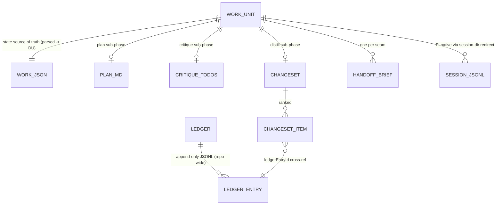

# Workflow layer — architecture & verification (shared)

This is the shared backbone for the three seam plans
([01-foundation](./01-foundation.md), [02-commands](./02-commands.md),
[03-distill-apply](./03-distill-apply.md)). It holds the binding conventions, the
module layout, and the verification & evidence strategy **once**, so the seam plans
carry only their tasks. Read this first; each seam plan assumes it.

## Design Docs

- [SPIKE: Pi transcript feasibility (resolved feasible)](../../../docs/spikes/2026-06-07-pi-transcript-feasibility-spike.md)
- [ADR 0001: Shape/Craft/Reflect workflow layer](../../../docs/adrs/0001-shape-craft-reflect-workflow-layer.md)
- [ADR 0002: Toolchain — Bun, single-package](../../../docs/adrs/0002-toolchain-bun-single-package.md)
- [Tech Spec: Workflow layer](../../../docs/specs/2026-06-07-workflow-layer-spec.md)
- [Parent design doc §10 (7-phase plan)](../../../docs/agent-harness-design.md)

## Architecture & Conventions (binding)

The engineering style is **governed elsewhere and not restated here**:

- **Functional core / imperative shell, hexagonal, immutability, illegal-states-unrepresentable,
  parse-at-the-boundary** — repo [`CLAUDE.md`](../../../CLAUDE.md) (functional architecture).
- **Error handling** (`Result`/`Task`/`Maybe` via `true-myth`, errors-as-`kind`-tagged-unions,
  exhaustive `match` + `never`, no `throw` for control flow) — the
  [`functional-error-handling`](../../skills/functional-error-handling/SKILL.md) skill.
- **Toolchain** (Bun as runtime + test runner + bundler + package manager; `tsc` is the type
  authority; gate = `bun test` && `bun x tsc --noEmit`; pin `@earendil-works/pi-coding-agent`
  exact; Bun↔Pi go/no-go gate + Node+`tsx`+`vitest` fallback) —
  [ADR 0002](../../../docs/adrs/0002-toolchain-bun-single-package.md).
- **Workflow-layer architecture commitment** (branch-linked work-unit folder, under-the-hood
  handoffs, transcript-mining distill) — [ADR 0001](../../../docs/adrs/0001-shape-craft-reflect-workflow-layer.md).
- **On-disk schemas, lifecycle state machine, gates, ledger** —
  [Tech Spec](../../../docs/specs/2026-06-07-workflow-layer-spec.md).

Only the **feature-specific bindings** live here:

- **Core = calculations, shell = actions.** The spec's algorithms are overwhelmingly pure:
  state transitions, slug derivation, signature hashing, recurrence/confidence math, distill
  synthesis (span-grouping, conflict resolution, ranking), routing taxonomy, brief validation,
  gate outcomes. These live in a pure `domain/` core over plain data, returning `Result`/`Maybe`.
  Everything effectful — git, filesystem, Pi session launch, subagent spawn, transcript reading,
  TUI prompts, clock, id/uuid — hides behind a **port** and is implemented by an **adapter** in
  the shell. Pi hooks + umbrella commands are the imperative shell wiring core + ports at a
  composition root.
- **In-core `WorkUnit` is a discriminated union on lifecycle state.** Each variant carries only
  the data legal in that state (only `blocked` has `blockedReason`; only `crafting` has
  `craftCheckpointRef`). The persisted `work.json` keeps the Tech Spec §1 shape; the boundary
  parser **lifts** it into the DU and the store **lowers** the DU back on write. Transitions are
  total and exhaustive.
- **Parse-once boundary set.** Every on-disk artifact is untrusted input parsed **exactly once**
  at the shell via an in-repo `parserFor`/`asyncParserFor` (`boundary/parsers.ts`, over plain
  `zod` + `true-myth`; `parserFor` → `Result`, `asyncParserFor` → `Task`):
  `work.json`, `*.json` briefs, `changeset.json`, `critique-todos.json`, each `ledger.jsonl`
  line. The core never re-validates.

### Module layout (ports & adapters)

```
src/
  domain/                      # FUNCTIONAL CORE — pure, no IO; returns Result/Maybe
    workunit/
      model.ts                 # WorkUnit discriminated union; const-union types; never-check helper
      transitions.ts           # transition(unit, event): Result<WorkUnit, TransitionError>  (total, exhaustive)
      recovery.ts              # recoveryAction(persisted): RecoveryAction
      slug.ts                  # deriveSlug(summary, {crc, salt}): Slug   (deterministic; entropy injected)
      gate.ts                  # gate-rejection retry decisions (Gate 1 / Gate 3) as pure reducers
    briefs/
      validate.ts              # validateBrief(brief, knownPaths): Result<ValidBrief, BriefError>
      render.ts                # renderBrief(valid): string   (system-prompt block, cache-eligible)
    ledger/
      signature.ts             # signature(finding): Signature   (sha256[0..12] of normalized core)
      recurrence.ts            # bump / confidence start+increment+cap / lazy 90-day decay (now injected)
    distill/
      lenses.ts                # 4 lens analyzers: (FileEntry[]) -> Finding[]   (pure over transcript entries)
      synthesis.ts             # synthesize(findings, ledger, now): Result<Changeset, SynthesisError>
      routing.ts               # routeFriction(finding): {routingType, artifactType}  (taxonomy)
    changeset/
      review.ts                # applyDecision(changeset, decision): Result<Changeset, ReviewError>  (reducer)
      apply-plan.ts            # decideApply(changeset): ApplyOutcome  (full/partial/full-reject)
    profiles.ts                # Seam-2 model-profile record (pure data, const)
  ports/                       # INTERFACES the core needs from the world (typed; Task/Result/Maybe)
    clock.ts ids.ts file-system.ts git.ts work-store.ts ledger-store.ts
    session-launcher.ts subagent-runner.ts transcript-reader.ts prompter.ts
  boundary/                    # PARSE-AT-THE-BOUNDARY — zod schemas + in-repo Result/Task parsers
    schemas.ts parsers.ts      # work.json, brief, changeset, critique-todos, ledger; lift/lower DU
  adapters/                    # IMPERATIVE SHELL — concrete port impls (Bun IO)
    bun-clock.ts uuid-ids.ts bun-fs.ts git-cli.ts
    pi-session-launcher.ts pi-subagent-runner.ts pi-transcript-reader.ts tui-prompter.ts
    work-store-fs.ts ledger-store-fs.ts
  shell/                       # ORCHESTRATION — commands + hooks wire core to ports
    hooks/{index,session-start,session-shutdown,before-agent-start,
           context,session-before-compact,tool-call}.ts
    commands/{shape,craft,reflect,apply}.ts
    phases/{explore,define,plan,craft,critique}.ts
    phases/distill/orchestrator.ts
  compose.ts                   # composition root: build real adapters, inject into shell
  cli.ts                       # entry point: dispatch /shape /craft /reflect /apply
test/
  domain/**                    # pure unit + property (fast-check) tests — zero IO, zero fakes needed
  support/fakes/**             # in-memory fake for every port (the test substrate)
  fixtures/transcripts/**      # recorded golden Pi JSONL + subagent JSON (record/replay corpus)
  replay/**                    # replay adapters: feed fixtures through shell deterministically
  acceptance/sc-*.test.ts      # one test per Success Criterion; each emits an evidence record
  architecture/boundaries.test.ts  # fitness fn: domain/ imports no IO/adapters/ports-impl/node/bun
  e2e/full-loop.test.ts        # whole-loop replay → whole-plan evidence artifact
```

Work-unit data artifacts (Tech Spec §1) and their cross-refs:



The lifecycle state machine (states, transitions, crash recovery) is specified in
**Tech Spec §2** — realized as the pure `domain/workunit/` core; not duplicated here.

## Verification & Evidence Strategy

The goal: after **every task, every commit, and the whole plan**, produce something that can
be **run, recorded, and replayed** to prove the work is complete *and* simple, elegant, and
high quality. Three levels, each with a concrete, automated proof.

### What makes this provable: the architecture is the test seam

Because effects hide behind ports, **every test is deterministic and offline**:

- The **pure core** needs no fakes — it is plain functions, exercised by example tests and
  **property-based tests** (`fast-check`) that assert invariants over thousands of generated
  inputs.
- The **shell** is tested by injecting **in-memory fakes** or **replay adapters** for the ports
  — never live models, git, or disk-of-record.

### Record · replay (the harness's own medium is the test substrate)

magpi's premise is mining Pi's append-only JSONL transcripts. That becomes the testing strategy:

1. **Record once.** Run each autonomous phase (plan / craft / distill) and the lens workers
   against a small fixture project; commit the resulting `sessions/*.jsonl` and subagent JSON
   outputs as **golden fixtures** under `test/fixtures/transcripts/`.
2. **Replay deterministically.** The distill lenses + synthesis are **pure over transcript
   entries**, so replay = feed golden entries in and **snapshot** the `changeset.json` out — no
   network, fully repeatable. For command orchestration, a **replay `SessionLauncher` /
   `SubagentRunner`** plays back a recorded transcript instead of spawning live Pi; a **scripted
   `Prompter`** plays back recorded human accept/reject/skip decisions. "Record once, play it
   back."
3. **Evidence record.** Each acceptance test writes a small machine-readable evidence entry
   (criterion id, fixtures used, assertions, pass/fail, key values) to `test/_evidence/` so the
   proof is itself inspectable and replayable — not just a green checkmark.

### Proving "simple, elegant, high quality" (mechanically, not by assertion)

> **Right-sized for greenfield agility.** The proofs below split into two tiers. The **day-one
> tier** is cheap, high-value, and does not ossify an unsettled design — it runs from the first
> commit. The **deferred ratchet** (strict coverage thresholds, complexity budgets, heavier
> rigor) is added *once the design stabilizes*, so verification never competes with iteration
> speed. The extra rigor is mostly for the implementer's own confidence; it is opt-in later, not
> an upfront tax.

**Day-one tier (from commit 1):**

- **Type safety:** `bun x tsc --noEmit` strict; zero `any`/`as` escapes in the core.
- **Architecture fitness test:** an automated test asserts `src/domain/**` imports nothing from
  `adapters/`, port implementations, `node:*`, `bun`, `child_process`, or `fs` — the
  dependency-direction proof that the core is genuinely pure and the hexagon holds.
- **Exhaustiveness:** every union `match`/`switch` ends in a `never` check; tsc fails if a case
  is missed — illegal states stay unrepresentable by construction.
- **Property tests for the pure core** (`fast-check`) and **record/replay** for the autonomous
  phases — correctness where it lives, deterministic and offline.
- **No-throw / no-hand-parse checks:** lint rule + a grep-based test that there is no `JSON.parse`
  on `.jsonl` outside the Pi loader (Tech Spec SC #7), and no `throw` for control flow in
  `domain/`. (Cheap, and they guard load-bearing invariants.)
- **`bun run verify`** runs exactly the above — fast, never blocks iteration.

**Deferred ratchet (added once the design stabilizes — not before):**

- **Coverage gate:** `bun test --coverage` with a threshold, core held higher than shell.
- **Simplicity/complexity budget** via Biome (max function length / cyclomatic complexity, no
  mutable shared state). Introduced as a follow-up so it tightens around a settled shape rather
  than freezing an exploratory one.

### The verification ritual (what to run at each level during `/workflows:work`)

| Level | Run | Record / replay | Proof of done |
|---|---|---|---|
| **Per task** | the task's own unit/property tests + the gate (`bun test` && `bun x tsc --noEmit`) | new fixtures if the task is a phase/worker | task's Definition-of-Done checks all green; fitness + lint clean |
| **Per commit** | `bun run verify` (gate + fitness + scans) + the acceptance test(s) that commit turns green | the recorded acceptance evidence for that commit's SC(s) | the commit's `Deployable` claim demonstrated by a named, replayable test |
| **Whole plan** | the full `test/acceptance/**` matrix + the replay-driven `e2e/full-loop` | the whole-plan evidence artifact (all SC evidence records + a full-loop replay) | every Success Criterion has a green, recorded, replayable proof |

### Acceptance matrix (every Success Criterion → a named, runnable test)

| SC | Proof test | Mechanism | Seam plan |
|---|---|---|---|
| SC #1 no manual `/compact` | `acceptance/sc-1-no-compact.test.ts` | replay full loop; assert no user `/compact` entry in any transcript | 03 (E2E) |
| SC #2 native transcript capture | `acceptance/sc-2-native-sessions.test.ts` | launch via redirect; assert one Pi-written `.jsonl` per session, no symlink/copy | 01 (Task 5) |
| SC #3 crash-safe craft resume | `acceptance/sc-3-craft-resume.test.ts` | kill mid-craft (replay), re-enter; assert state + checkpoint SHA intact | 02 (Task 22) |
| SC #4 recurrence-gated distill | `acceptance/sc-4-recurrence.test.ts` | replay 2 work units sharing friction; assert changeset item `recurrenceCount>=2` | 03 (Tasks 26/28) |
| SC #5 Gate-1 retry cap | `acceptance/sc-5-gate1-cap.test.ts` | property/example: reject plan twice → state reverts to `shaping (define)` | 02 (Task 20) |
| SC #6 partial Gate-3 | `acceptance/sc-6-partial-apply.test.ts` | accept some/reject some → applied + ledger `rejected` + `completed` | 03 (Task 30) |
| SC #7 loader-only JSONL | `acceptance/sc-7-loader-only.test.ts` | static scan: no `JSON.parse` on `.jsonl` outside the loader | 01 (Task 5) |
| SC #8 six hooks fire | `acceptance/sc-8-hooks-fire.test.ts` | run with hook-call logging; assert all six fired without error | 01 (Task 14) |

The matrix as a whole (one test per SC + machine-readable evidence records) is delivered by
**Task 34**, and the full-loop E2E by **Task 36** — both in [03-distill-apply](./03-distill-apply.md).
The "Seam plan" column above points at where each SC's *mechanism* first becomes exercisable.
