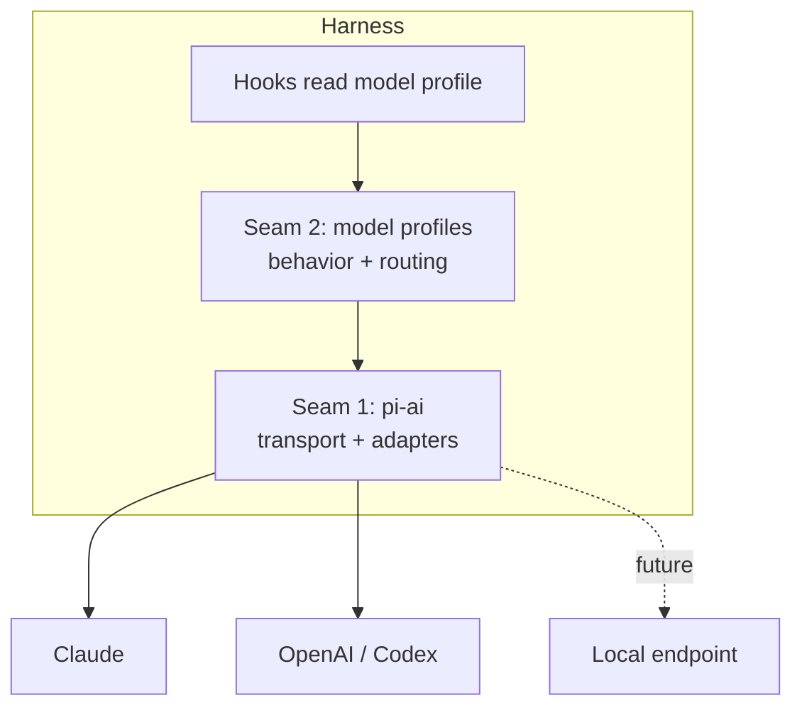
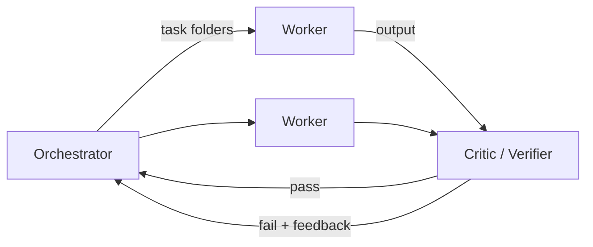

# Magpi — Design & Decision Record

> Working design doc for **Magpi**, a model-agnostic agent harness built on Pi
> (`@earendil-works/pi-*`), with context-engineering principles baked in throughout.
> Goal: a harness we like more than Claude Code for our own workflows.

[[_TOC_]]

## 1. The name: Magpi

**Magpi** — the magpie, with `pi` at its core. Chosen deliberately after wide
divergence and saturation vetting. The reasons it stuck:

- **Pi at the core.** Built on Pi (`@earendil-works/pi-*`), and "Mag**pi**" carries
  that lineage literally inside the name.
- **The magpie as mascot.** Magpies are among the most intelligent animals — tool
  use, caching, mirror self-recognition — and they gather and curate exactly what
  they need. A fitting emblem for a context-engineering harness that collects and
  curates context.
- **Clear namespace.** The main historical collision, *The MagPi* (Raspberry Pi's
  magazine), was retired — renamed *Raspberry Pi Official Magazine* around issue
    151. No AI/agent-space collision surfaced in vetting, unlike many candidates we
         eliminated for in-domain saturation (e.g. ecotone, stigmergy, vellum).
- **The bridge.** In Chinese culture the magpie (喜鹊) is the bird of joy and good
  fortune, and the Qixi legend has magpies forming a bridge (鹊桥, the "magpie
  bridge") across the heavens to join two separated sides. That maps directly onto
  Magpi's job: the bridge in the *between-space*, connecting model providers that
  otherwise can't meet — the same edge-effect intuition behind the provider-agnostic
  design.

> **TODO (before committing):** claim the namespaces deliberately — npm (bare +
> scoped), the GitHub org/repo, and the `.ai`/`.dev`/`.sh` domains. `magpi.cc` and
> legacy magazine recognition still exist, so search-level clearance isn't a guarantee.

## 2. Context & motivation

We want an agent harness that is transparent, controllable, and model-agnostic,
with context engineering as a first-class concern rather than an afterthought.
Pi is the chosen foundation because it is a minimal, four-tool core
(`read`, `write`, `edit`, `bash`) with a sub-1,000-token system prompt and an
extension system that exposes exactly the hooks we need to shape context.

**Quality strategy:** drive output quality with a multi-agent topology
(orchestrator → worker → critic) using *backpressure* — both as a quality gate
(critic must pass work before it is accepted) and as a resource limit (bounded
concurrency over the inference backend). This spends extra tokens deliberately,
on verification, rather than wastefully.

## 3. Goals / non-goals

### Goals
- Model-agnostic harness that runs against any supported provider with no refactor.
- Context engineering implemented through Pi's extension hooks, parameterized per model.
- Incremental multi-agent backpressure that is added only where evals show it helps.
- A repeatable, head-to-head evaluation against Claude Code to justify each decision.

### Non-goals (for now)
- Local/self-hosted inference and the hardware to run it (deferred — see §9).
- A polished GUI; the Pi TUI (`pi-tui`) is sufficient for the foreseeable future.
- Supporting every provider on day one; start with the two we actually use.

## 4. Workflow & commands

Magpi exposes a three-command lifecycle. The commands are imperative maker's verbs
— the work has taste, not just output — and each phase tightens from open to defined.

```
/shape    → explore · define · plan
/craft
/reflect  → critique · distill
```

- **`/shape`** — turn a formless idea into a committed plan. Sub-steps: `explore`
  (divergent ideation), `define` (write the spec), `plan` (lay out execution). The
  arc moves from open to defined, mirroring the verb.
- **`/craft`** — do the work, with judgment and taste. No sub-steps.
- **`/reflect`** — close the loop. Sub-steps: `critique` (judge the result with
  taste — both the code and the run) and `distill` (boil the run down to the
  durable lesson worth keeping).

`reflect`'s distilled lessons feed back into the next `shape`/`craft` cycle — the
self-correcting loop, and the same feedback intuition behind the backpressure
design (§6.3).

> **Workflow layer fully specified.** The design above is now formalized end-to-end in
> dedicated records (these supersede this sketch for the workflow layer):
> [SPIKE: Pi transcript feasibility](spikes/2026-06-07-pi-transcript-feasibility-spike.md)
> (resolved — Pi natively persists mineable JSONL transcripts; session dir is redirectable),
> [ADR 0001: Shape/Craft/Reflect workflow layer](adrs/0001-shape-craft-reflect-workflow-layer.md)
> (the architecture commitment), and
> [Tech Spec: Workflow layer](specs/2026-06-07-workflow-layer-spec.md)
> (work-unit folder schema, lifecycle state machine, gates, `/distill` + learnings ledger).
> Key refinement from those records: the loop runs over a **branch-linked work-unit folder**
> (`.magpi/work/<slug>/`), with `/shape` switching pi into the unit's `sessions/`, so
> transcripts land natively per work unit and seams hand off under the hood
> (auto-clear-and-reseed) — no manual `/compact`.

## 5. Decisions so far

| ID | Decision | Rationale | Status |
|----|----------|-----------|--------|
| D1 | Build on Pi (`pi-ai`, `pi-agent-core`, `pi-coding-agent`, `pi-tui`) | Minimal, transparent, model-agnostic core with the right extension hooks | Accepted |
| D2 | Cloud-first: Anthropic (Claude) + OpenAI (Codex). Local inference deferred | No capex, pay-per-token, frontier quality for personal-scale projects | Accepted |
| D3 | Two-seam model abstraction (see §6.1) | Avoid reimplementing `pi-ai`; isolate behavior/policy from transport | Accepted |
| D4 | Context engineering via Pi's four extension hooks (see §6.2) | Map write/select/compress/isolate onto real events; keep it explicit | Accepted |
| D5 | Multi-agent orchestrator → worker → critic with backpressure | Drive quality via verification + bounded concurrency; add incrementally | Accepted (incremental) |
| D6 | Head-to-head evaluation vs Claude Code using existing skill-eval framework | Prove "as good or better," don't assume it | Accepted |
| D7 | Name the project **Magpi** | `pi` at the core; magpie gathers/curates context; clear namespace; "magpie bridge" = the between-space joining providers (see §1) | Accepted |
| D8 | Three-command lifecycle: `shape` → `craft` → `reflect` (see §4) | Descriptive imperative verbs; map brainstorm/spec/plan → work → review/learn; `reflect` feeds the loop | Accepted |

## 6. Architecture

### 6.1 Two-seam model abstraction

The "model-agnostic interfaces + per-provider implementations" instinct is correct,
but it lives at **two distinct seams**. Conflating them leads to reimplementing Pi.

- **Seam 1 — transport / provider abstraction.** Chat, streaming, normalized
  tool-call wire formats, token/cost accounting. **This is `pi-ai`.** The
  per-provider adapters (Anthropic, OpenAI, …) already exist. _Do not rebuild
  this._ If we find ourselves writing a `ChatCompletion` interface with our own
  `AnthropicClient` / `OpenAIClient`, stop — that is `pi-ai`.
- **Seam 2 — model capability / behavior profile.** _This is ours to build._ A
  typed, discriminated record keyed by model (data, not a class hierarchy) that
  encodes everything that is **not** wire-format:
    - system-prompt style / structure preferences
    - whether to expose thinking / reasoning, and the thinking budget
    - parallel-tool-call support
    - context-window size and prompt-caching behavior
    - routing role (worker / orchestrator / critic) and weight

The context hooks (§6.2) read from the Seam-2 profile instead of hardcoding
per-model assumptions. Adding a model becomes adding a profile entry; the eventual
local swap is just one more profile plus an endpoint — no new adapter.



### 6.2 Context engineering hooks

Map Lance Martin's write/select/compress/isolate taxonomy onto Pi's extension events.
Each hook is a hot-reloadable TypeScript module and reads from the Seam-2 profile.

| Principle | Pi event | Responsibility |
|-----------|----------|----------------|
| Write | `before_agent_start` | Assemble system prompt + skills + task brief; progressive disclosure (load docs/skills on demand) |
| Select | `context` | Filter the message array each turn: drop stale tool results, pull in only currently-relevant files |
| Compress | `session_before_compact` | Custom multi-stage summarization that preserves file-operation history and tool-failure data |
| Isolate | (subagent sessions) | Keep each subagent's context separate; coordinate via the filesystem, not a shared window |
| (gate) | `tool_call` | Permission/validation gating; enforce the concurrency semaphore for subagent-spawning tools |

> **TODO:** decide the per-model profile schema and where it is sourced (config file vs. code).
> **TODO:** define the compaction pipeline stages precisely.

### 6.3 Multi-agent topology & backpressure



Two forms of backpressure:

1. **Quality gate (the point):** the critic must pass a worker's output before the
   orchestrator accepts it; failures route back with structured feedback. This is
   where the "extra tokens" are spent productively.
2. **Resource backpressure:** a bounded semaphore over the inference backend so N
   concurrent agents never exceed what the backend serves without latency collapse.
   Enforced in the `tool_call` hook for subagent-spawning tools.

**Coordination:** one folder per task (instructions + outputs as files) rather than
message-passing. Keeps each agent's context isolated, clean, and trivially observable.

**Model routing:** per-role via the Seam-2 profile — fast/cheap model for the worker
swarm, a stronger model for orchestrator/critic.

> **Note:** with frontier cloud models the base quality is already high, so start
> with little or no gating and add critic loops only where evals show a lift.

## 7. Model strategy

- **Now (cloud):** Anthropic + OpenAI/Codex, routed per role via Seam-2 profiles.
- **Cost control:** lean on prompt caching for the orchestrator pattern (stable
  system-prompt + context reused across turns); watch spend via Pi's built-in
  token/cost tracking.
- **Later (local, deferred):** open-weight frontier options to revisit —
  GLM-5.1, Kimi K2.6 (strong at sub-agent parallelism), MiniMax M3, and
  Qwen3-Coder-Next / GLM-4.7-Flash for a fast worker tier.

> **TODO:** pin specific model IDs per provider and per role once profiles exist.

## 8. Evaluation

Reuse the existing **skill-eval** framework as the judge. Run the same task suite
through (a) Magpi and (b) Claude Code, score head-to-head, and let the numbers
drive which backpressure / context-engineering features earn their keep.

> **TODO:** define the task suite and scoring rubric.
> **TODO:** decide the baseline Claude Code configuration to compare against.

## 9. Hardware (deferred)

Cloud-first means no hardware purchase now. Captured here so the key insight is not
lost when local is revisited:

> The backpressure design is a **concurrent** workload, not single-stream. Optimize
> for **aggregate throughput under continuous batching**, not batch-1 latency. That
> means serving with **vLLM or SGLang** (not Ollama/llama.cpp), and it means a
> Mac Studio's unified memory — great capacity, weak concurrent serving and prefill —
> is the *wrong* buy for a swarm despite the hype.

<details>
<summary>Reference tiers (for when local is revisited)</summary>

- **Prosumer (~$8–12k):** one RTX Pro 6000 (96 GB). Runs worker-tier MoE models with good concurrency.
- **Serious local server ($30k+):** 2–4× RTX Pro 6000 (tensor parallelism) or used H100/H200; required for GLM-5.1/Kimi-class models at interactive speed *with* concurrency.
- **Consumer reference:** RTX 5090 (32 GB) ≈ 100–150 tok/s on ~13B Q4; caps at ~30B-class models.

</details>

## 10. Phased plan

- [ ] **Phase 1 — stand up Pi.** `pi-coding-agent` against a cloud provider; confirm the loop on one model.
- [ ] **Phase 2 — context hooks.** Implement the four extension modules (`before_agent_start`, `context`, `session_before_compact`, `tool_call`) as hot-reloadable TS, reading from Seam-2 profiles.
- [ ] **Phase 3 — Seam-2 profiles.** Define the typed model-profile record; add Claude + Codex profiles.
- [ ] **Phase 4 — workflow commands.** Implement `/shape` (explore · define · plan), `/craft`, `/reflect` (critique · distill) over the loop.
- [ ] **Phase 5 — multi-agent.** Orchestrator/worker/critic spawning + file-based coordination + concurrency semaphore.
- [ ] **Phase 6 — evals.** Wire skill-eval as the judge; run head-to-head vs Claude Code.
- [ ] **Phase 7 — tune.** Add backpressure/gating only where evals show a lift.

## 11. Open questions

- [ ] Profile schema: config-file-driven or code-driven? Where does it live in the repo?
- [ ] Compaction pipeline: exact stages and what is always preserved.
- [ ] Subagent lifecycle: process-per-agent vs. in-process sessions; failure/retry semantics.
- [ ] Semaphore tuning: how to size concurrency against provider rate limits (not just GPU).
- [ ] Observability: what to log at the token level, and how to surface it in the TUI.
- [ ] Command surface: are `shape`/`craft`/`reflect` top-level commands, or sub-commands of a `magpi` CLI? How do sub-steps get invoked?

## 12. References

**Internal design records**
- [SPIKE: Pi transcript feasibility](spikes/2026-06-07-pi-transcript-feasibility-spike.md) — resolved; what the Pi runtime provides natively (transcripts, hooks, session-dir redirect, SDK).
- [ADR 0001: Shape/Craft/Reflect workflow layer](adrs/0001-shape-craft-reflect-workflow-layer.md) — the workflow-layer architecture commitment.
- [Tech Spec: Workflow layer](specs/2026-06-07-workflow-layer-spec.md) — full implementable design.

**External**
- Pi coding agent (author writeup): https://mariozechner.at/posts/2025-11-30-pi-coding-agent/
- Pi tutorial (packages & extension API): https://nader.substack.com/p/how-to-build-a-custom-agent-framework
- Pi monorepo: `badlogic/pi-mono` on GitHub (npm scope `@earendil-works/pi-*`; author: Mario Zechner)